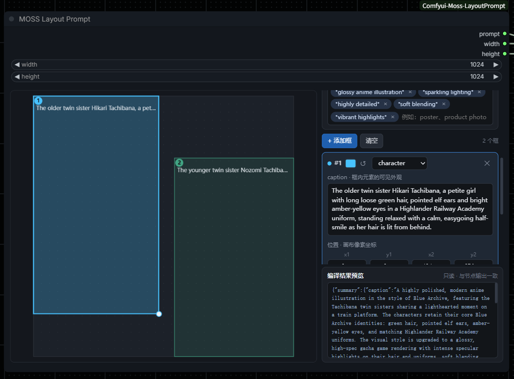
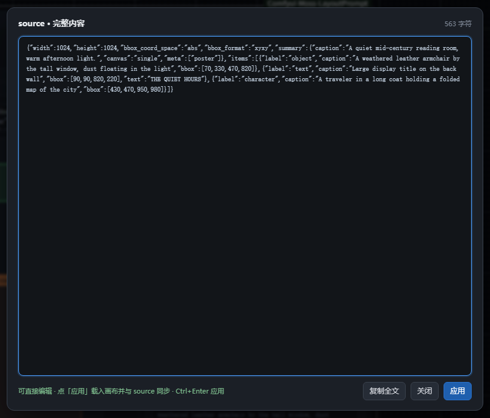

# MOSS Layout Prompt for ComfyUI

[English](README.md) | 简体中文

MOSS-Image 的 JSON Layout 提示词画布编辑器。在画布上为每个元素画一个框，
右侧每个框一行编辑，节点输出编译后的提示词以及工作流应使用的画布尺寸。

本插件提供两个节点：稳定版 **MOSS Layout Prompt**，以及在其之上增加外部草稿输入的
**MOSS Layout Prompt (Advance)**（**实验阶段**）。



## 安装

本插件独立成包。把本目录放到 `ComfyUI/custom_nodes/` 下，使其位于
`ComfyUI/custom_nodes/moss-layoutPrompt-LP/`，重启 ComfyUI 即可。它只使用 ComfyUI
自身提供的依赖，自带节点与前端扩展，不与其他插件共享代码。

自带的示例工作流通过 MOSS-Image 节点加载模型，因此该工作流还需要另行安装
[MOSS-Image](https://github.com/OpenMOSS/MOSS-Image) 节点包。

## 工作流

1. 下载 [moss-layout-prompt.json](example_workflows/moss-layout-prompt.json)，拖入 ComfyUI。
2. 在 **MOSS-Image HF Loader** 中填写本地模型目录。
3. 在画布上绘制布局，点击 **Run** 生成图片。

工作流已把 `prompt` 接到 `CLIPTextEncode`，把 `width`/`height` 接到
`EmptyFlux2LatentImage`，因此布局画布与生成图片的尺寸始终一致。

## 节点

两个节点都在 `moss-layoutPrompt-LP` 分类下，共用同一个画布编辑器，输出也完全相同。

> **实验阶段：**`MOSS Layout Prompt (Advance)` 仍在开发中，输入与行为可能随版本变化；
> 需要长期稳定的工作流请继续使用 `MOSS Layout Prompt`。两个节点总是一起发布，同一份
> 草稿产出的提示词完全一致。

### MOSS Layout Prompt (Advance) — 实验阶段

节点 ID `MOSSImageLayoutPromptAdvance`。原节点再加上外部草稿输入：`source` 接受草稿
JSON、已编译提示词或旧版 scene 提示词，并载入画布。`source` 与画布双向同步：在
`source` 里输入/粘贴会载入画布，画布上的任何修改也会把当前草稿写回 `source`。输入框带
`source` 标签条，标签条是按钮，点击会在弹窗里显示**可编辑**的完整内容（输入框本身只显示
两行）；在弹窗里改好后点「应用」即可载入画布并同步回 `source`。



| 输入 | |
| --- | --- |
| `width`、`height` | 画布与图片尺寸，须为 16 的正整数倍。 |
| `source` | **实验阶段。**外部草稿文本。粘贴草稿 JSON（可夹杂无关文字，也可以是已编译的 `abs_centralized`/`yxyx`）后会载入画布；画布上的修改也会把当前草稿同步写回这里。没有编辑器时直接编译，但仅当画布没有框。 |
| `layout` | 草稿 JSON。编辑器会隐藏它；画布不可用时可直接手写。 |

### MOSS Layout Prompt — 稳定版

节点 ID `MOSSImageLayoutPrompt`。原节点保留，已保存的工作流仍可正常加载。画布编辑器、
输出、`width`/`height`/`layout` 输入都与上面相同，只是没有 `source`。它的 `layout` 也接受
MOSS-Image 旧版 scene schema（`scene_type` / `gen_brief` / `elements`），会按节点的画布尺寸转换。

| 输出（两个节点相同） | |
| --- | --- |
| `prompt` | 供 `CLIPTextEncode` 使用的编译后提示词。 |
| `width`、`height` | 供潜空间节点使用的画布尺寸。 |

## 编辑器

- 右侧顶部的 `画布尺寸` 提供两种改画布的方式。`自定义` 模式直接输 `宽` 和 `高`；
  `预设` 模式选一个比例（`1:1`、`3:2`、`16:9`、`21:9`……）和一个长边，再由
  `横屏` / `竖屏` 决定长边是宽还是高——`16:9` 配 2560、横屏就是 2560×1440。
  长边左侧的下拉列出常见取值，点开即可套用；右侧输入框可以填任意值，选中
  `自定义…` 会把光标送到输入框。所有尺寸都会吸附到后端要求的 16 的倍数，卡片标题
  右侧实时显示百万像素面积（`2560 × 1440 · 3.69 M`）。模式在加载时按当前画布反推，
  重新打开工作流就能看到它实际用的比例。`自定义` 模式没有比例控件，改在下方标出当前
  尺寸对应的比例（如 `比例 16:9`），落在预设表外时给出实际比值——导入外部提示词后
  用它一眼确认比例是否正确。粘贴外部草稿时同样会吸附（向上取整，只放大不缩小，
  免得裁掉贴边的框），并在状态栏说明吸附前后的尺寸；
  打开一份旧工作流时若画布不是 16 的倍数，不会改动它已存的数据，只在卡片标题右侧
  标出 `非 16 倍数`，等你决定怎么改。标题栏的 `▾` 可以收起整块控件，只留尺寸与面积
  读数；折叠状态记在浏览器本地，不写进草稿，也不影响节点输出。
- 底部的 `编译结果预览` 与节点输出完全一致。右侧 `复制` 复制当前所见内容，
  `复制草稿` 复制含画布尺寸与原始坐标的草稿（贴回 `source` 能完整还原）。
  预览头部可在 `JSON` 与 `文本` 之间切换：`JSON` 是规范写法，提示词里的 `\(`
  会按 JSON 规则写成 `\\(`，可以直接回贴；`文本` 把反斜杠还原成一个，方便阅读或
  交给别的工具。注意 `文本` **不是合法 JSON**，贴回时靠解析器的容错才能读入，
  而且成对的反斜杠（如 LaTeX 的 `\\`）会丢成一个——要完整还原请用 `复制草稿`。
- 在画布空白处拖动新建框，框内拖动移动，拖右下角圆点缩放（悬停该框或选中它时
  显示圆点）；也可以在行内直接输入 `x1, y1, x2, y2`。
- 框重叠时，每个框左上角的编号标签条是最可靠的抓手：先说编号，随后按框的宽度显示
  尽可能多的 caption（文字框显示要渲染的 text），最后是四向移动图标。标签条画在所有
  框之上，整条底色区域都可以点击——编号、文字或图标——点它就选中该框，从它拖就是移动
  该框；框越窄显示的文字越少。在重叠区同一位置重复点击会在堆叠的框之间轮换；如果其中
  一个框已经选中，第一次点击不会把它换掉，所以拖动不会被意外抢走。
- 每个框的坐标显示两行：上一行是 `x1, y1, x2, y2` 像素值，下一行是同样四条边占画布的
  百分比。两行都能直接输入，画布随输入即时变化；数值会被夹在画布内，并保证相邻两边
  至少相差 8px。
- `对齐到 8` 把所有框的四条边向上取整到 8 的整数倍，宽高因此也落在 8 的网格上，
  便于与 latent 网格对齐；取整后仍限制在画布内，也不会塌成 0 面积。
- 右侧编辑总提示词，以及每个框一行：`label`（`object`、`character`、`text`）、
  `caption`（元素外观）和文字元素需要渲染的 `text`。`caption`、`text` 与总提示词
  都是多行输入框，会随内容自动增高。`caption` 可以为空，`text` 不行——后端要求
  `text` 区域必须有内容，所以某个 `text` 框被删空时，分区列表上方会出现常驻警告并
  标红该卡片，提醒你在执行前补上内容或把 `label` 改回 `object`。
- `meta` 标签是胶囊：输入后回车或逗号添加；点击胶囊文字即可就地编辑，点击编辑框以外的任意位置
  （或回车）完成编辑，`Esc` 取消，`×` 移除。
- `添加框` 新建框，`✕` 删除该框，`清空` 清空画布。选中框后按 `Delete` 或退格键也会
  删除该框；光标在输入框内时保持正常编辑，且编辑器获得焦点时这两个键不会误删整个节点。
- `全部清空`（红色，仅 Advance 节点）清空**所有内容**：全部框、总提示词、`meta` 标签和
  `source` 外部输入；画布尺寸保留。
- `从文件导入` 从磁盘载入草稿 JSON 文件并放进画布。文件里的 JSON 可以夹杂无关文字或
  被代码块包裹，会自动提取出对象；若导入的是已编译的 `abs_centralized`/`yxyx` 提示词或
  旧版 `scene_type`/`elements` 提示词，会按节点的 `width`/`height` 反解成草稿。转换后如果
  框超出画布，会围绕画布中心等比缩放到画布内。
  注意：**编译后的提示词本身不含画布尺寸**（后端只输出 `summary`、`items` 和两个格式字段），
  所以贴回这种提示词时画布尺寸不会被改动，只能按当前画布换算；要完整还原尺寸，请用
  `复制草稿` 得到的格式，或先把画布设成原尺寸再粘贴。

## 草稿与编译后的提示词

编辑器保存草稿，节点输出编译后的提示词。草稿框是画布左上角原点的
`[x1, y1, x2, y2]` 像素坐标：

```json
{
  "width": 1024,
  "height": 1024,
  "bbox_coord_space": "abs",
  "bbox_format": "xyxy",
  "summary": {"caption": "A minimalist travel poster..."},
  "items": [{"label": "text", "caption": "A large title.", "text": "EXPLORE", "bbox": [128, 96, 896, 224]}]
}
```

执行时节点会把每条件减去画布中心并重排为 `yxyx`，得到 MOSS-Image 需要的
`abs_centralized` 提示词。没有框的草稿会退化为其 summary caption，
因此未编辑的节点等同于普通文本提示词。

校验只针对草稿的结构：画布尺寸、框的几何、`label` 取值和字段名。caption 属于内容，
总提示词或某个框的 caption 留空是允许的，节点照常运行。`text` 是例外——它就是要渲染
的那句话，不能为空，所以编辑器在编辑时就提示，而不是等到执行才报错。

草稿也可以通过 `source` 输入传入：粘贴或导入后会载入画布，之后以画布为准继续编辑；
如果是已编译的 `abs_centralized`/`yxyx` 提示词，会先用节点的 `width`/`height` 反解回草稿。
没有编辑器时 `source` 会被直接编译，但仅当画布上没有框。

读取 `source` 时刻意做得很宽松，因为提示词很少以干净的 JSON 形式出现。经过提示词
处理的 caption 会把括号转义成 `\(` `\)` 以免被当作权重语法——这在 JSON 里是**非法转义**，
解析器会先修补这些反斜杠再解析，读进节点后 caption 仍然是 `\(`。同一个值也可能被
序列化两次（工作流把 widget 的字符串当字符串存），或外面包着 `{"layout": …}` /
`{"draft": …}` / `{"source": …}` 信封，这两种都会拆开，最多拆四层。对象前后夹着
说明文字或代码块也没关系，解析器会直接扫出对象本身。拆完仍不像草稿（缺 `summary`、
`items`、`elements`）的内容一律拒绝，**不会动画布**——所以误贴一个无关对象不会清空
你画好的框，只会得到一句提示。

编辑或粘贴 `source` 会**立即重新应用**（即使文本内容没变，也会重新载入以替换画布）；
反过来，编辑器会把画布的最新草稿同步写回 `source`（在输入框内打字时不会打扰你，离开
输入框后自动整理成标准草稿）。因此 `source` 中始终是可直接编译的草稿：旧的粘贴内容、
已编译提示词或旧版 scene 提示词都会先转换再写回，运行节点也不会再用过期内容覆盖你在
画布上的修改。刷新界面或执行生成都不会重放 `source`：只要画布上有框，就以画布草稿为准。

字段规范、坐标系与构图要求见 MOSS-Image 仓库中的
[references/layout.md](https://github.com/OpenMOSS/MOSS-Image/blob/main/skills/moss-image-prompt-enhancer/references/layout.md)
与[用户指南](https://github.com/OpenMOSS/MOSS-Image/blob/main/USERGUIDE_ZH.md)。

编辑器需要支持 DOM widget 的 ComfyUI 前端。不支持时节点仍可运行，
直接手写 `layout` 文本框即可。

## 许可

Apache-2.0，见 [LICENSE](LICENSE)。
